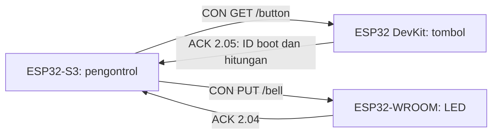
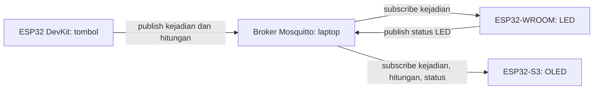

# CoAP & MQTT Demo dengan ESP32

Proyek pembelajaran dua protokol IoT menggunakan **tiga ESP32, sebuah tombol, LED, dan OLED SSD1306**. Demo CoAP memakai GET/PUT antarperangkat; demo MQTT memakai publish/subscribe melalui broker Mosquitto di laptop.

Tekan tombol pada ESP32 DevKit untuk menyalakan LED eksternal di ESP32-WROOM selama sekitar satu detik. Pada versi MQTT, ESP32-S3 juga menampilkan penghitung tombol dan status perangkat pada OLED.

## Perangkat

| Komponen | Jumlah | Penggunaan |
| --- | --- | --- |
| ESP32 DevKit | 1 | Membaca push button |
| ESP32-WROOM development board | 1 | Mengendalikan LED eksternal |
| ESP32-S3 development board | 1 | Pengontrol CoAP / monitor OLED MQTT |
| Push button | 1 | Input kejadian |
| LED dan resistor 330 ohm | 1 set | Indikator bel |
| OLED SSD1306 128x64 I2C, 4 pin | 1 | Monitor MQTT |
| Breadboard, kabel jumper, kabel USB | Secukupnya | Sambungan dan daya |
| Laptop Windows | 1 | Arduino IDE dan broker MQTT lokal |
| Wi-Fi/hotspot 2,4 GHz | 1 | Jaringan bersama |

Board tombol dan penerima menggunakan ESP32 klasik dengan GPIO18 tersedia. Ikuti label GPIO pada board, bukan nomor urut kaki.

## CoAP dan MQTT dalam proyek ini

| Aspek | Demo CoAP | Demo MQTT |
| --- | --- | --- |
| Pola komunikasi | Request/response, GET dan PUT | Publish/subscribe berdasarkan topik |
| Transport yang digunakan | UDP | TCP |
| Port demo | 5683 | 1883 |
| Perantara pesan | Komunikasi langsung antar-ESP | Broker Mosquitto di laptop |
| Tugas S3 | Membaca tombol dan mengirim perintah LED | Subscribe dan menampilkan status pada OLED |
| Fitur yang dicoba | Resource, CON, ACK, kode respons | Topik, QoS1, retained message, Last Will |

Ini adalah perbandingan dua implementasi dalam proyek, bukan batasan seluruh kemampuan protokol. Kedua demo berjalan pada jaringan lokal tanpa memerlukan internet setelah dependensi tersedia.

### Alur CoAP



Panduan dan penjelasan resource: [demo CoAP](demo_tombol/README.md).

### Alur MQTT



Panduan broker, topik, dan OLED: [demo MQTT](demo_mqtt/README.md).

## Rangkaian

### Tombol pada ESP32 DevKit

```text
GPIO18 ----- tombol ----- GND
```

Program memakai `INPUT_PULLUP`: dilepas = HIGH, ditekan = LOW. Untuk tombol empat kaki, pilih dua kontak yang baru tersambung ketika ditekan.

### LED eksternal pada ESP32-WROOM

```text
GPIO18 ----- resistor 330 ohm ----- anoda LED (+)
                                   katoda LED (-) ----- GND
```

Pasang resistor dan LED secara seri. Kedua kaki satu komponen tidak boleh dimasukkan ke kelompok lubang breadboard yang sudah saling terhubung. Sketch penerima memiliki tes dua kedipan saat reset untuk memeriksa rangkaian.

### OLED pada ESP32-S3, khusus demo MQTT

| OLED | ESP32-S3 |
| --- | --- |
| VCC | 3V3 |
| GND | GND |
| SDA | GPIO8 |
| SCL | GPIO9 |

Periksa label pin pada modul OLED. Program mencari alamat `0x3C` atau `0x3D`; jika GPIO8/9 digunakan fungsi lain pada board, sesuaikan `OLED_SDA` dan `OLED_SCL`.

## Persiapan setelah clone

```powershell
git clone https://github.com/Nomad37301/CoAP-MQTT-Demo.git
cd CoAP-MQTT-Demo
.\Setup-LocalConfig.ps1
```

Script menyalin template menjadi `NetworkConfig.h` pada keenam folder sketch, dan mempertahankan konfigurasi lokal yang sudah ada. Buka tab tersebut di Arduino IDE untuk mengisi SSID dan password jaringan. File konfigurasi lokal diabaikan Git; password tidak diperlukan dalam repository.

Jika PowerShell memblokir script lokal, jalankan menggunakan proses PowerShell terpisah:

```powershell
powershell.exe -NoProfile -ExecutionPolicy Bypass -File .\Setup-LocalConfig.ps1
```

Pilih profil board yang sesuai pada Arduino IDE. Pengujian kompilasi menggunakan `ESP32 Dev Module` untuk kedua ESP32 klasik dan `ESP32S3 Dev Module` untuk S3. Serial Monitor memakai **115200 baud**.

### Dependensi Arduino

| Paket/library | Versi saat pemeriksaan | Digunakan oleh |
| --- | --- | --- |
| esp32 by Espressif Systems | 3.3.11 | Semua sketch |
| CoAP simple library, Hirotaka Niisato | 1.4.0 | CoAP |
| MQTT, Joel Gaehwiler / 256dpi | 2.5.3 | MQTT |
| Adafruit SSD1306 | 2.5.17 | OLED |
| Adafruit GFX Library | 1.12.6 | OLED |
| Adafruit BusIO | 1.17.4 | OLED |

Pasang paket ESP32 lewat Boards Manager dan library lewat Library Manager. Library MQTT yang dipakai menyediakan header `MQTT.h`.

## Menjalankan CoAP

1. Isi SSID/password pada tab `NetworkConfig.h` di ketiga sketch CoAP, lalu hubungkan ketiga ESP ke jaringan yang sama.
2. Upload `demo_tombol/01_button_server/01_button_server.ino` ke ESP tombol. Catat `BUTTON IP` dari Serial Monitor.
3. Upload `demo_tombol/03_led_receiver/03_led_receiver.ino` ke ESP LED. Catat `RECEIVER IP`.
4. Isi `BUTTON_IP` dan `RECEIVER_IP` di `demo_tombol/02_controller_s3/NetworkConfig.h` dengan kedua IP tersebut.
5. Upload `demo_tombol/02_controller_s3/02_controller_s3.ino` ke S3. Tunggu pesan **Sinkronisasi tombol**, lalu tekan tombol.

Tidak diperlukan broker untuk demo CoAP. OLED belum digunakan pada versi ini.

## Menjalankan MQTT

1. Isi SSID/password pada tab `NetworkConfig.h` di ketiga sketch MQTT. Laptop dan ketiga ESP harus bergabung ke jaringan yang sama. Pengujian awal memakai hotspot A51; nama jaringan bisa disesuaikan.
2. Siapkan [Mosquitto untuk Windows](https://mosquitto.org/download/). Script mendukung instalasi di `C:\Program Files\mosquitto` atau salinan portabel di `.build/mosquitto`.
3. Dari folder repository, jalankan:

   ```powershell
   .\demo_mqtt\Start-Broker.ps1
   ```

   Script memilih IP Wi-Fi laptop, mengisi `MQTT_HOST` pada ketiga konfigurasi, lalu menjalankan broker. Biarkan terminal terbuka. Jika perlu, tentukan IP atau lokasi executable:

   ```powershell
   .\demo_mqtt\Start-Broker.ps1 -BrokerIp 192.168.43.100 -MosquittoPath 'C:\Program Files\mosquitto\mosquitto.exe'
   ```

   IP tersebut hanya contoh. Jika Windows Firewall meminta akses broker, sesuaikan izin dengan jaringan demo yang dipakai.

4. Upload `02_led_subscriber` ke WROOM, `03_oled_monitor_s3` ke S3, dan `01_button_publisher` ke DevKit. Ketiganya berada dalam folder `demo_mqtt`.
5. Tunggu koneksi MQTT, lalu tekan tombol. LED menyala sekitar satu detik; OLED menampilkan hitungan dan status LED.

Jika IP laptop berubah, jalankan script lagi dan upload ulang ketiga sketch. Konfigurasi broker contoh menggunakan port TCP 1883 tanpa login/TLS untuk jaringan demo lokal.

### Topik MQTT

| Topik | Payload | Retain |
| --- | --- | --- |
| `demo/button/press` | `ID_BOOT:HITUNGAN`, contoh `deadbeef:1` | Tidak |
| `demo/button/count` | Jumlah tekanan sejak board tombol hidup | Ya |
| `demo/led/state` | `ON` / `OFF` | Ya |
| `demo/button/status` | `online` / `offline` | Ya |
| `demo/led/status` | `online` / `offline` | Ya |
| `demo/oled/status` | `online` / `offline` | Ya |

Semua publish/subscription demo memakai QoS1. ID kejadian membantu penerima mengabaikan pengiriman ulang kejadian terakhir. Pesan kejadian tidak di-retain agar subscriber baru tidak memutar ulang bel lama.

## Struktur repository

```text
.
|-- README.md
|-- Setup-LocalConfig.ps1
|-- demo_tombol/
|   |-- NetworkConfig.template.h
|   |-- 01_button_server/
|   |-- 02_controller_s3/
|   |-- 03_led_receiver/
|   `-- README.md
|-- demo_mqtt/
|   |-- NetworkConfig.template.h
|   |-- 01_button_publisher/
|   |-- 02_led_subscriber/
|   |-- 03_oled_monitor_s3/
|   |-- Set-BrokerIp.ps1
|   |-- Start-Broker.ps1
|   `-- README.md
`-- scripts/
    `-- Test-MqttBroker.ps1
```

`NetworkConfig.h`, konfigurasi broker runtime, dependensi unduhan, dan hasil kompilasi `.build/` dibuat secara lokal dan diabaikan Git. Mosquitto dan library pihak ketiga dipasang terpisah; binary hasil build tidak diperlukan untuk membaca atau membangun sumber proyek.

## Pemeriksaan dan batasan

- Keenam sketch dasar telah berhasil dikompilasi dengan versi dependensi di atas. Riwayat pemeriksaan tiap demo tercantum pada README masing-masing.
- Pemilik proyek telah melaporkan kedua demo berhasil dijalankan pada perangkat.
- Broker lokal diuji untuk QoS1 ke dua subscriber, retained count, kejadian tanpa retain, dan Last Will. Untuk mengulang pengujian di Windows dengan Mosquitto tersedia:

  ```powershell
  .\scripts\Test-MqttBroker.ps1
  ```

- Penghitung dan ID kejadian disimpan di RAM. Contoh belum menyediakan antrean persisten semua tekanan saat offline. Status LED adalah keadaan output menurut program, bukan hasil sensor cahaya yang mengukur LED secara fisik.
- Retained message memberikan nilai terakhir, bukan seluruh riwayat kejadian. Last Will muncul setelah broker mendeteksi putusnya koneksi.

## Referensi

- [CoAP RFC 7252](https://www.rfc-editor.org/rfc/rfc7252.html)
- [CoAP simple library](https://github.com/hirotakaster/CoAP-simple-library)
- [MQTT library untuk Arduino](https://github.com/256dpi/arduino-mqtt)
- [Eclipse Mosquitto](https://mosquitto.org/)
- [Adafruit SSD1306](https://github.com/adafruit/Adafruit_SSD1306)
- [Dokumentasi Arduino ESP32](https://docs.espressif.com/projects/arduino-esp32/en/latest/)
